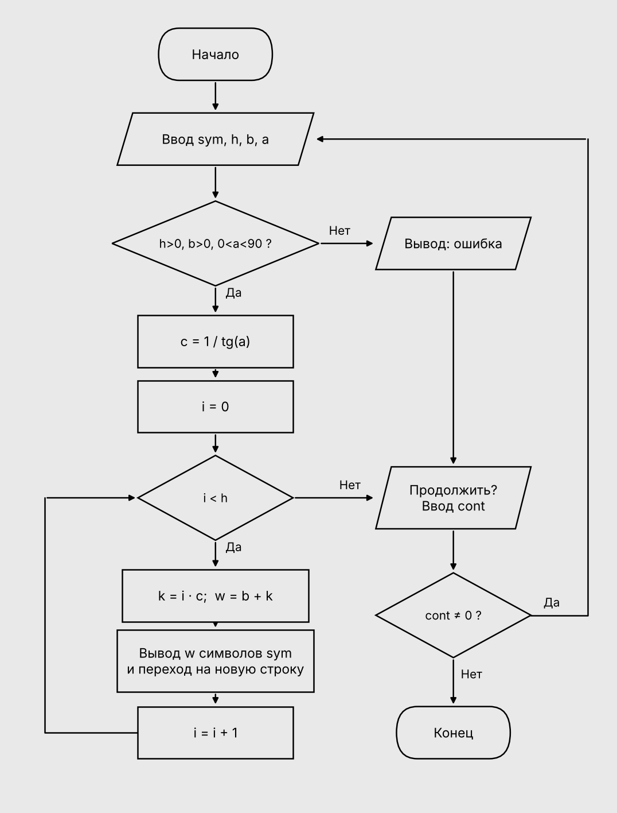

# Индивидуальное задание к теме 9

## Условие задачи

Написать программу, выводящую на экран заданную геометрическую фигуру, нарисованную с помощью заданного с клавиатуры символа. 
Вариант 13: прямоугольная трапеция, заполнение контура — да, задаваемые пользователем параметры: h (высота), b (верхнее основание), угол a.

## Алгоритм

1. Начало.
2. Ввести символ sym, высоту h, основание b и угол a.
3. Если h ≤ 0, b ≤ 0, a ≤ 0 или a ≥ 90, вывести сообщение об ошибке.
4. Иначе вычислить c = 1 / tg(a) (a переводится в радианы).
5. Для каждой строки i от 0 до h − 1:
   - вычислить k = округлённое значение i · c (на сколько строка длиннее верхней);
   - вычислить ширину строки w = b + k;
   - вывести w символов sym и перейти на новую строку.
6. Спросить, продолжать ли работу. Если введено не 0, повторить с пункта 2.
7. Конец.

## Блок-схема

## Код

```c
#define _CRT_SECURE_NO_WARNINGS
#include <stdio.h>
#include <math.h>
#include <locale.h>

#define PI 3.14159265358979323846

int main()
{
    char sym;
    int h, b, k, i, j, w, cont;
    double a, c;
    setlocale(LC_ALL, ".UTF-8");
    do
    {
        printf("Введите символ, из которого будет строиться фигура:\n");
        scanf(" %c", &sym);
        printf("Введите высоту h:\n");
        scanf("%d", &h);
        printf("Введите верхнее основание b:\n");
        scanf("%d", &b);
        printf("Введите угол a в градусах (от 1 до 89):\n");
        scanf("%lf", &a);

        if (h <= 0 || b <= 0 || a <= 0 || a >= 90)
            printf("Ошибка: h и b должны быть больше 0, угол от 1 до 89.\n");
        else
        {
            c = 1.0 / tan(a * PI / 180.0);
            printf("Закрашенная прямоугольная трапеция:\n\n");
            for (i = 0; i < h; i++)
            {
                k = (int)(i * c + 0.5);
                w = b + k;
                for (j = 0; j < w; j++)
                    printf("%c", sym);
                printf("\n");
            }
        }
        printf("\nПродолжить ? (Да - введите любое число, Нет - введите 0)\n");
        scanf("%d", &cont);
    } while (cont != 0);
    return 0;
}
```

## Информация о разработчике

Коренев Сергей, группа 6ИД-261 подгруппа 2
